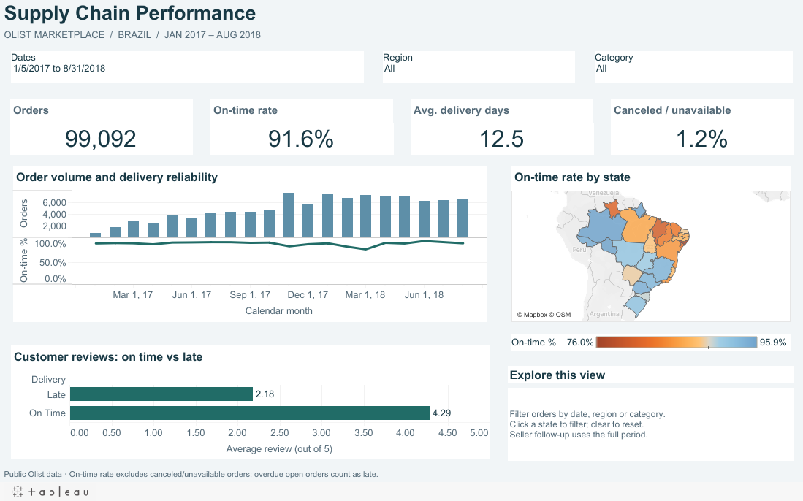

# Supply Chain Analytics: Delivery Performance

An ELT pipeline that loads 100K e-commerce orders and a public-holiday API into Postgres. It cleans and checks the data with SQL, computes delivery and supplier KPIs, flags exceptions that need action, and feeds a Tableau dashboard.

> This rebuilds, on public data, the supply-chain dashboard and pipeline I built as a Data Analyst at Think and Wash. The original work used internal company data that I can't share.

**Live Tableau dashboards:** [Delivery overview](https://public.tableau.com/app/profile/sourav.gupta7998/viz/Supply_Chain_Performance/SupplyChainPerformance) · [Seller follow-up](https://public.tableau.com/app/profile/sourav.gupta7998/viz/Supply_Chain_Performance_seller/Sellerfollow-up)

[Download the packaged workbook](dashboard/Supply_Chain_Performance.twbx) · [Build and validation notes](dashboard/README.md)

[](https://public.tableau.com/app/profile/sourav.gupta7998/viz/Supply_Chain_Performance/SupplyChainPerformance)

## Problem

Operations needs answers to three questions every month:
- Where are deliveries late, and is it getting worse?
- Which sellers (suppliers) cause the delays?
- What needs action right now?

The numbers have to come from one trusted pipeline, not hand-edited spreadsheets.

## Pipeline

```
Olist CSVs (9 files) ─┐
                      ├─► raw ─► clean ─► mart ─► checks ─► exports/*.csv ─► Tableau Public
Holiday REST API ─────┘   as-is   typed,    KPI     3 rules   order_facts, kpi_monthly,
                          (text)  keys,     views             seller_performance,
                                  CHECKs                      exceptions (alerts)
```

| Step | File | What it does |
|---|---|---|
| Extract + load | [etl.py](etl.py) | Lands every CSV in Postgres as text with `COPY`, and pulls national holidays from [Nager.Date](https://date.nager.at) |
| Clean | [sql/clean.sql](sql/clean.sql) | Sets data types, removes duplicates and fixes bad dates. 7 foreign keys and 4 CHECK constraints stop the load if the source breaks a rule. |
| Model | [sql/marts.sql](sql/marts.sql) | Builds the order-level fact view, 8 KPIs per state per month, monthly seller handover performance, and the exceptions (alerts) |
| Check | [sql/checks.sql](sql/checks.sql) | Rules the constraints can't express: no orders lost or duplicated, no missing months, API data present |
| Export | [etl.py](etl.py) | Writes CSVs for Tableau |

The whole run is one transaction and takes about 12 seconds. If any step fails, nothing changes.

## Data

[Olist Brazilian E-Commerce](https://www.kaggle.com/datasets/olistbr/brazilian-ecommerce) (CC BY-NC-SA 4.0): 99,441 orders, 112,650 items and 3,095 sellers across 27 states.

**Data-quality issues found and handled:**
- **Impossible carrier dates:** 189 handover dates fall before the purchase or after the delivery. They're treated as unknown instead of trusted.
- **Duplicate reviews:** 551 extra review rows exist because some orders were reviewed more than once. Only the latest review per order is kept.
- **Missing translations:** 13 products have categories missing from the English translation file, so they keep their Portuguese name. 610 products have no category at all.
- **Sparse edges:** orders are sparse before 2017 and after Aug 2018, so reporting covers **Jan 2017 – Aug 2018** (99,092 orders). The window is defined once, in `mart.period`.
- **Orders that never arrived:** 1,707 orders were never delivered and are past their promised date. A naive "delivered late" KPI leaves them out, which inflates on-time from **91.6% to 93.2%**. Here they count as late.

## Results

| KPI (Jan 2017 – Aug 2018) | Value |
|---|---|
| Orders | 99,092 |
| On-time delivery | 91.6% |
| Late deliveries | 8,239 |
| Failed orders (cancelled or unavailable) | 1.2% |
| Average delivery time | 12.5 days |
| Seller late-handover rate | 9.0% |
| Average review | 4.09 / 5 |
| Freight share of order value | 14.2% |

**Findings:**
- **Late deliveries destroy reviews.** Late orders average 2.18 stars against 4.29 for on-time orders. 65% of late orders get 1–2 stars, compared with 9% of on-time orders.
- **Seller delays carry through to customers.** When a seller hands over to the carrier late, the delivery is late 22% of the time, against 6% otherwise. That makes supplier follow-up the most direct lever.
- **Two bad periods.**
  - In Nov 2017, Black Friday brought 63% more orders than October, and on-time fell to 86%.
  - In Feb–Mar 2018, on-time fell to 85% and then 79% without a volume spike. The North and Northeast fell to about 70%.
  - The data doesn't contain the cause (carrier, weather, strikes). That would be the next question for the logistics team.
- **The Northeast is the weakest region all year:** 88% on time in normal months, against about 94–95% in the South and Southeast.
- **Holidays aren't the problem.** Orders with a national holiday in their delivery window are late 8.5% of the time, against 8.3% without one.

## Alerts

`mart.exceptions` lists what needs action in the latest month, against business thresholds. Running it for Aug 2018 flags:
- **2 states below 90% on-time:** MS at 71.4%, PB at 89.7%.
- **19 sellers with late-handover rates above 20%** (at least 10 items shipped). Three of them are above 70%.

The alerts are written to `exports/exceptions.csv` on every run.

## How to run

Tested with Python 3.12 and PostgreSQL 16. Download the Kaggle dataset into `data/` first.

```bash
pip install -r requirements.txt
createdb supply_chain
python etl.py        # set DATABASE_URL if your connection isn't "dbname=supply_chain user=postgres"
```

To automate it, schedule a daily run with cron:

```
0 6 * * * cd /path/to/supply-chain-analytics && python etl.py >> etl.log 2>&1
```

## What I'd do next

- **Send alerts:** post `exceptions.csv` to Slack or email instead of only writing a file.
- **Live dashboard:** connect Tableau Server or Cloud straight to Postgres, so it refreshes without re-publishing.
- **Explain the Feb–Mar 2018 drop:** join carrier data to find the cause.
- **Migrate to dbt:** move the SQL into dbt for lineage and tests once there's more than one pipeline.
